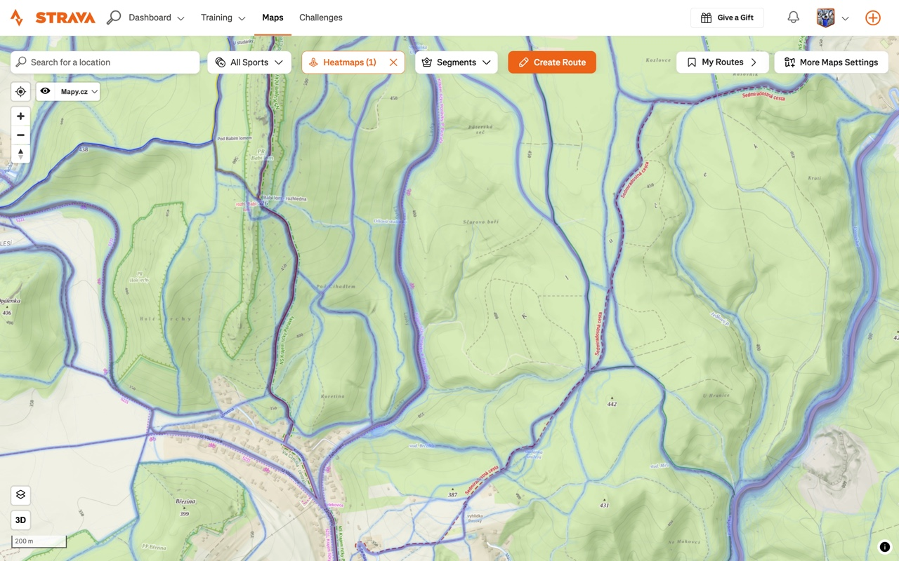
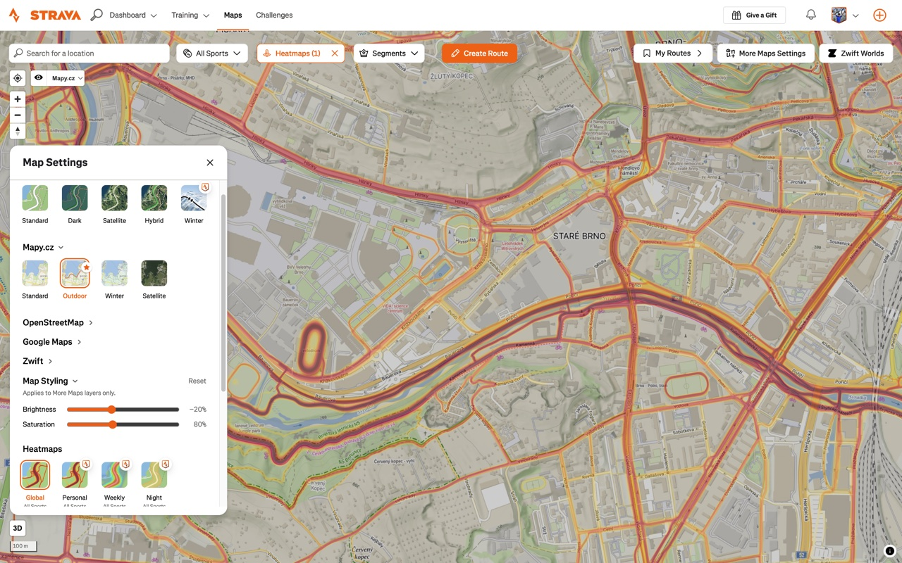
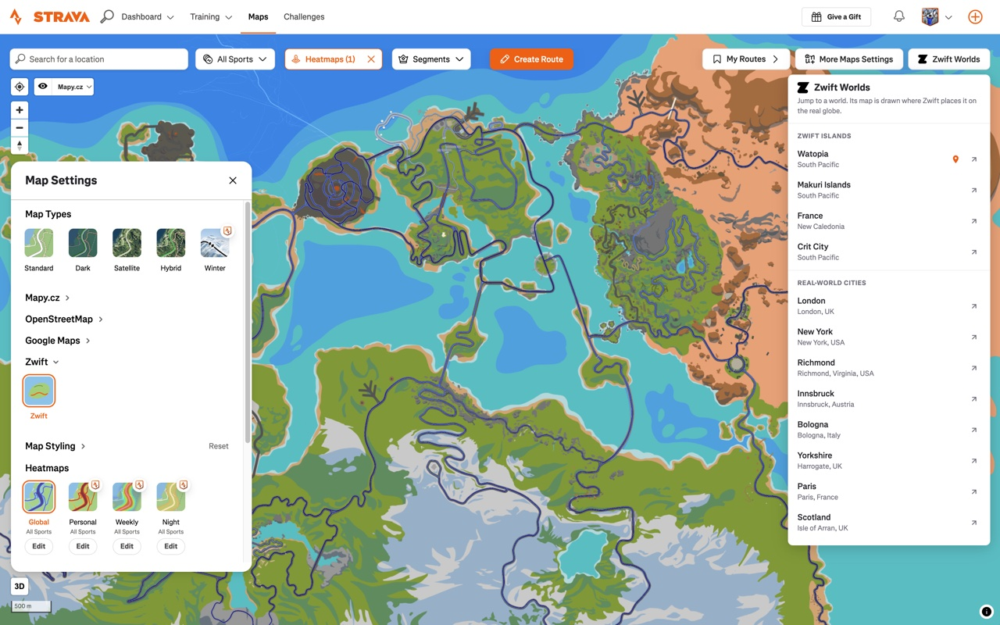
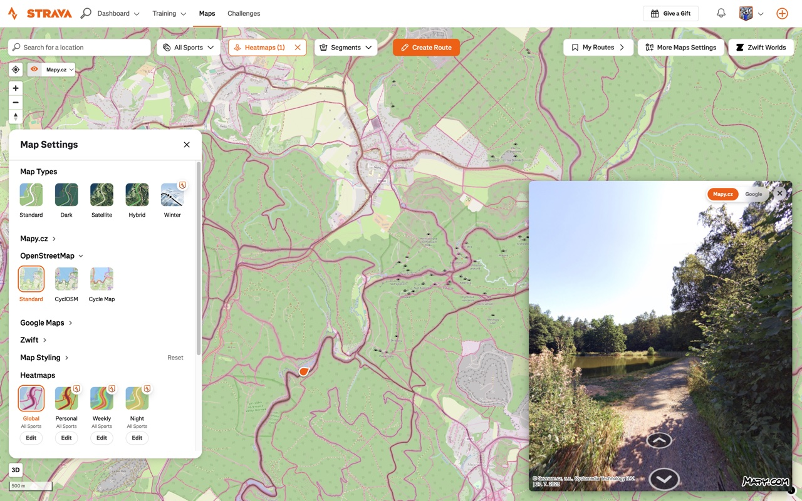
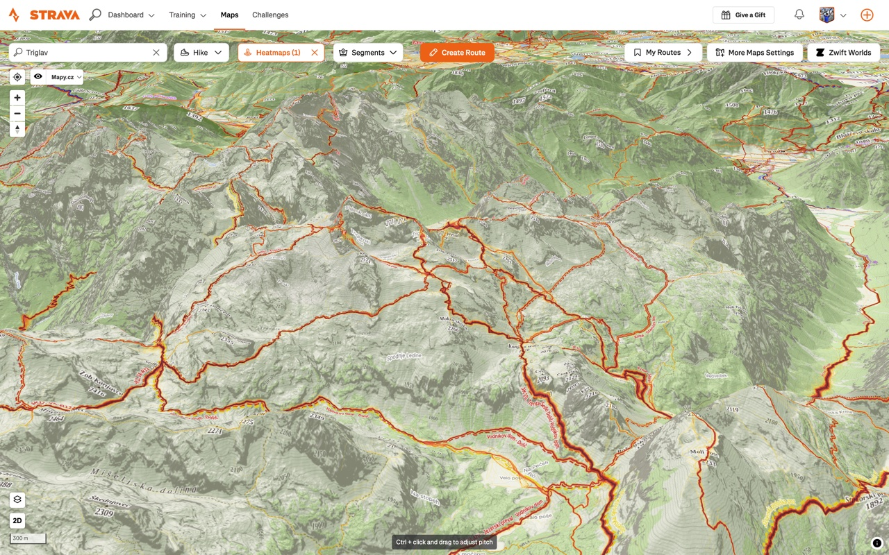
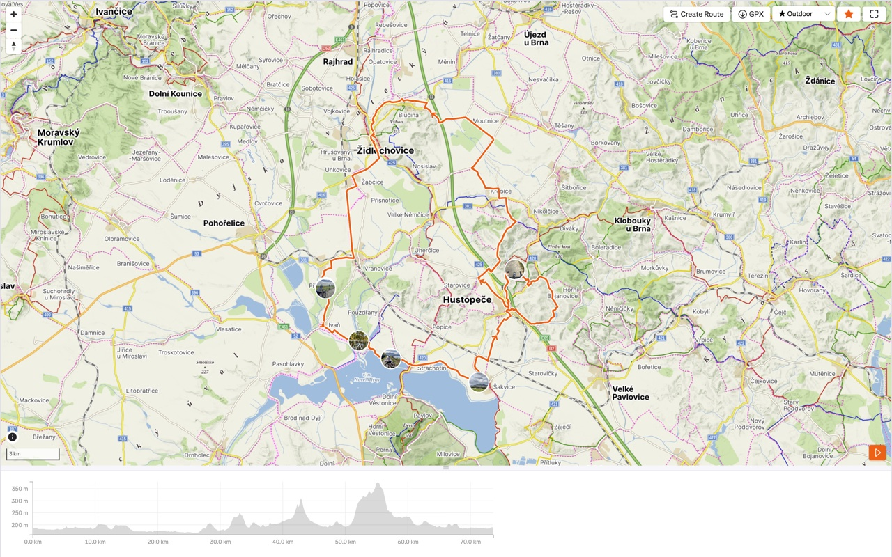

<div align="center">
  
  <h1>More Maps for Strava</h1>
  <p>
    <a href="https://chromewebstore.google.com/detail/more-maps-for-strava/adpgjdeigiekdjnjionhhblgfpmkionl">Chrome Web Store</a>
    ·
    <a href="https://addons.mozilla.org/en-US/firefox/addon/more-maps-for-strava/">Firefox Add-ons</a>
    ·
    <a href="https://github.com/mstrlc/more-maps-for-strava/releases/latest">Download</a>
  </p>
</div>

A browser extension that puts more base maps, Zwift's worlds and a street-level panorama mode into Strava's maps. Swap Strava's map for Mapy.cz, OpenStreetMap or Google Maps on the global heatmap, the route builder and activity pages, while Strava's heatmap, routes and markers keep drawing on top.

<p align="center">
  
  
  
  
  
  
</p>

## Features

- **Eleven extra base maps.** Mapy.cz (Standard, Outdoor, Winter, Satellite), OpenStreetMap (Standard, CyclOSM, Thunderforest Cycle Map) and Google Maps (Standard, Satellite, Terrain, Hybrid).
- **Built into Strava's own menus.** On the heatmap and route builder the maps appear in Strava's **Change map style** menu, grouped by provider in collapsible sections that remember their state. On activity pages they are extra groups in the map style dropdown.
- **Strava stays on top.** The heatmap, routes, segments and markers keep rendering over the custom map, and picking any of Strava's own styles switches back. Strava's own road and rail lines are hidden underneath, so they don't double up with the custom map's. Turn on Strava's **3D** view and the custom map drapes over the terrain, heatmap included.
- **Zwift worlds.** One layer draws all twelve Zwift worlds where Zwift places them on the real globe: Watopia, Makuri Islands, France and Crit City in the South Pacific, and London, New York, Richmond, Innsbruck, Bologna, Yorkshire, Paris and Scotland over the real cities. Your virtual rides in the heatmap line up with Zwift's roads. The **Zwift Worlds** button next to **More Maps Settings** lists every world, marks the one you're looking at, links to its routes on [ZwiftMap](https://zwiftmap.com) and jumps there in one click. Real terrain is flattened under the made-up islands, so their art isn't lifted by the islands underneath. Activities recorded in Zwift, yours or anyone else's, open on Zwift's map once you've allowed the extension to load Zwift's images (one click the first time). The rest is opt-in: a one-time card asks whether you ride Zwift, and the switch stays in **More Maps Settings**.
- **Favorite map.** Star a map and it loads automatically whenever you open a Strava map.
- **Map styling.** Brightness and saturation sliders for the custom maps, so a busy map can fade behind the heatmap. Strava's own layers are left untouched.
- **Panorama mode.** Click anywhere on the heatmap or route builder to open street-level imagery from Mapy.cz Panorama (Czech Republic) or Google Street View (worldwide) in a draggable, resizable window. A marker on the map shows where the camera stands and turns as you look around.
- **Your keys stay yours.** Providers that need an API key use your own free key, stored only in your browser's local storage.

## Install

Install from the [Chrome Web Store](https://chromewebstore.google.com/detail/more-maps-for-strava/adpgjdeigiekdjnjionhhblgfpmkionl) (Chrome, Edge and other Chromium browsers) or from [Firefox Add-ons](https://addons.mozilla.org/en-US/firefox/addon/more-maps-for-strava/).

To load it by hand instead, download `moremaps.zip` from [Releases](https://github.com/mstrlc/more-maps-for-strava/releases/latest) and unzip it. In Chrome or Edge, open `chrome://extensions`, turn on **Developer mode**, click **Load unpacked** and pick the unzipped folder. In Firefox, open `about:debugging#/runtime/this-firefox`, click **Load Temporary Add-on** and pick its `manifest.json`.

## Requirements

- Chrome, Edge or another Chromium browser, or Firefox 109 or later
- Free API keys for the providers that need one. Enter them under **More Maps Settings** in Strava's map navigation, next to **My Routes**. The free tiers need no credit card and cover personal use.

| Key | Needed for | Get one |
| --- | --- | --- |
| Mapy.cz (~1 min) | Mapy.cz maps and Mapy.cz Panorama | [developer.mapy.com](https://developer.mapy.com/account/projects): create an account and a project, then copy its API key |
| Google Maps (~3 min) | Google Street View only; the Google maps work without a key | [Google Cloud Console](https://console.cloud.google.com/google/maps-apis/credentials): create a project, enable the **Maps JavaScript API** (Chrome, Edge) and the **Maps Embed API** (Firefox), then create an API key |
| Thunderforest (~1 min) | Thunderforest Cycle Map | [manage.thunderforest.com](https://manage.thunderforest.com/): create an account and copy its API key |

OpenStreetMap Standard and CyclOSM need no key, and neither do the Zwift worlds. The first time you open them, the extension asks for permission to download Zwift's world maps from `cdn.zwift.com`; nothing of Zwift's is bundled with the extension.

## Building

```bash
git clone git@github.com:mstrlc/more-maps-for-strava.git
```

```bash
cd more-maps-for-strava && npm install
```

```bash
npm run build
```

The build is a plain file copy into `dist/`, with no bundler. Load `dist/` as an unpacked extension (or `dist/manifest.json` in Firefox) as described under [Install](#install), and reload it there after each build. `npm run zip` builds and packages `moremaps.zip`.

There are no automated tests. Releases are published to both stores by GitHub Actions when a `vX.Y.Z` tag is pushed; [CLAUDE.md](CLAUDE.md) has the full branch and release workflow.

## Usage

Open the [global heatmap](https://www.strava.com/maps/global-heatmap), the [route builder](https://www.strava.com/maps/create) or any activity page.

| To | Do this |
| --- | --- |
| Switch the base map | Pick a map in Strava's **Change map style** menu, or the map style dropdown on an activity page |
| Go back to Strava's map | Pick any of Strava's own map styles |
| Set a favorite map | Click the star on a map in the menu, next to the dropdown on an activity page, or choose it in **More Maps Settings** |
| Explore Zwift's worlds | Turn on **Show Zwift worlds** in **More Maps Settings** (or answer the one-time card), then click **Zwift Worlds** in the map navigation and pick a world, or pick **Zwift** in the map style menu |
| Fade or tint the custom map | Drag the **Brightness** and **Saturation** sliders under **Map Styling** in the map style menu |
| Turn panorama mode on or off | Click the eye button on the map, or press **P** |
| Look around a spot | With panorama mode on, click the map |
| Switch panorama provider | Use the switch at the top of the panorama window, or the dropdown next to the eye button |
| Enter API keys | Click **More Maps Settings** in the map navigation |

Panorama mode works on the heatmap and route builder, not on activity pages.

## Project layout

```
manifest.json            Manifest V3 extension manifest
constants.js             Map options, Strava selectors and storage keys (window.MoreMapsConfig)
strings.js               User-visible text
map-modifier.js          Content script: injects the page scripts, the menu entries,
                         the panorama button, the settings modal and the Zwift worlds panel
inject.js                Page script: finds Strava's map engine and swaps its base tiles,
                         recolours tiles for the brightness and saturation sliders,
                         and cuts Zwift's world maps into tiles
background.js            Downloads Zwift's world maps (cdn.zwift.com allows no page access)
zwift-permission.html    Asks for the optional cdn.zwift.com permission (with zwift-permission.js)
panorama.js              Page script: panorama mode, the floating window and map marker
panorama.html            Sandboxed page hosting the panorama viewers
panorama-sandbox.js      Loads Mapy.cz Panorama or Google Street View inside the sandbox
panorama-mapy-sdk.js     Bundled Mapy.cz panorama SDK
browser-polyfill.js      webextension-polyfill, so one codebase runs in Chrome and Firefox
assets/                  Map thumbnails, store badges and screenshots
icons/                   Extension icons
store/                   Store listing descriptions and screenshots
.github/workflows/       Release workflow publishing to the Chrome Web Store and Firefox Add-ons
```

## License

More Maps for Strava is released under the [MIT License](LICENSE). You may use, modify and redistribute it, provided the copyright notice stays with it.

Zwift world positions come from [zwift-data](https://github.com/andipaetzold/zwift-data) by Andi Pätzold (MIT). Zwift and its world maps are the property of Zwift, Inc.; this project is not affiliated with or endorsed by Zwift or Strava.
